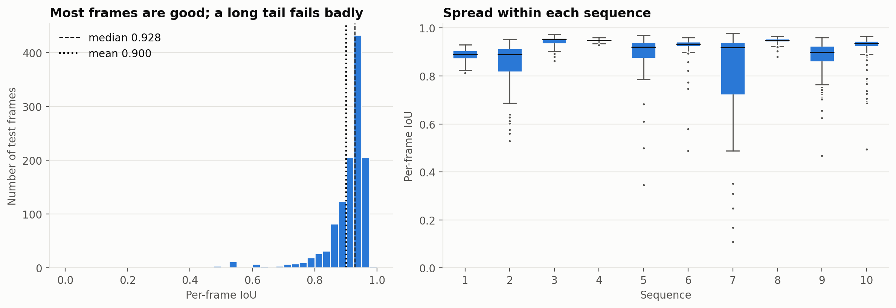
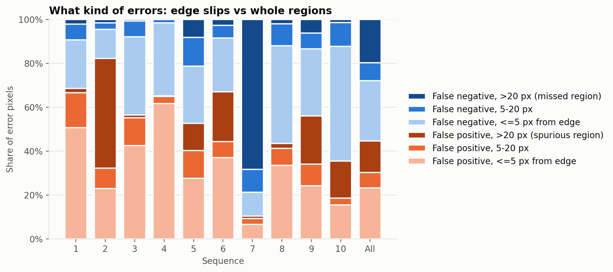
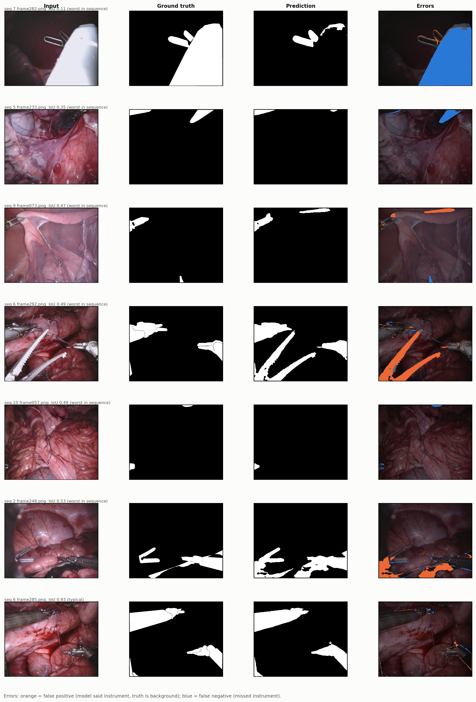
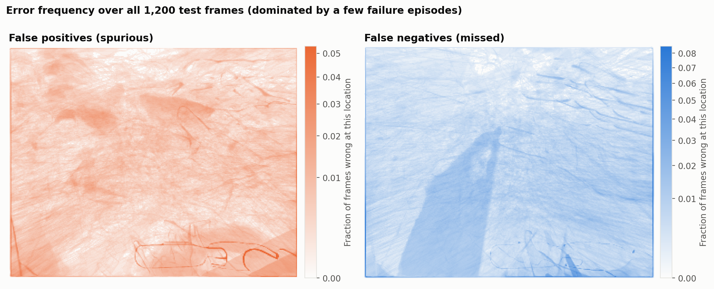

# Error analysis

Why and where the trained U-Net (ResNet34) fails on the 1,200 official test
frames (sequences 1-8: frames 225-299; sequences 9-10: all 300 frames).
Overall mean IoU is 0.900 (median per frame 0.928).

Everything here comes from per-frame results computed by
`scripts/evaluation/per_frame_errors.py` and summarized by
`scripts/analysis/error_analysis.py` (see [Reproduce](#reproduce)). Where a
statement is my reading of an image rather than something measured, it says
so.

## Summary

1. **Most frames are good; the shortfall is spread out.** 1,053 of 1,200
   frames (88%) score 0.85 or higher. The 44 frames below 0.7 (3.7% of
   frames) account for 17.5% of the total IoU shortfall; the other ~82% comes
   from ordinary frames that are slightly off.
2. **About half of all error pixels are edge slips.** 51% of error pixels
   lie within 5 px of the true boundary. In a typical frame the errors are a
   thin outline around each instrument.
3. **Gross failures come in a few kinds of events**, not random frames: a
   large, bright instrument body that was missed (sequence 7); non-instrument
   objects or unlabelled tools predicted as instrument (sequences 2, 5, 6, 9,
   10); and tiny slivers of instrument at the frame edge that were missed.
4. **Failures are temporal episodes.** Neighbouring frames are nearly
   identical, so e.g. 13 failing frames in sequence 2 are really one event.
   The 44 bad frames are only about a dozen distinct events.
5. **Biggest single event:** sequence 7, frames 267-283 (17 frames, 1.4% of
   the test set) cost 8% of the total shortfall. Without them pooled IoU
   would be 0.907 instead of 0.900.



## 1. Typical frames: edge precision

The model is rarely wrong about *what* is an instrument on an ordinary
frame; it is wrong about exactly where the edge is.

- Across all test frames, 51% of error pixels are within 5 px of the true
  boundary (23% false positive, 27% false negative) and 15% are 5-20 px away.
  The remaining 34% are "gross" (more than 20 px from the other mask).
- Sequence 4 is the clearest case: mean IoU 0.949, minimum 0.928, and 95% of
  its error pixels are within 5 px of the edge. Sequences 3 and 8 are close
  behind (0.944 and 0.947, 78% edge-slip share each).
- Overall the model under-segments slightly: 55% of error pixels are false
  negatives and 45% are false positives.

A plausible reason these frames plateau near 0.95 is label precision: the
ground truth is hand-drawn polygons, and the challenge paper notes a single
annotator per image with one expert review, blur at fast instrument motion
making edges ambiguous, and instrument holes that were never annotated. The
best challenge teams also top out at 0.949 on datasets 3 and 4. I did not
measure label noise, so treat this as a likely explanation, not a finding.



## 2. Failure modes

Per-sequence summary (false-positive share = share of error pixels that are
false positives; boundary / gross share = error pixels within 5 px /
more than 20 px of the other mask):

| Sequence | Mean IoU | Median IoU | Min IoU | Frames < 0.7 | False-positive share | Boundary share | Gross share |
|---|---:|---:|---:|---:|---:|---:|---:|
| 1 | 0.887 | 0.890 | 0.813 | 0 | 69% | 73% | 4% |
| 2 | 0.837 | 0.890 | 0.528 | 13 | 82% | 36% | 51% |
| 3 | 0.944 | 0.952 | 0.863 | 0 | 56% | 78% | 2% |
| 4 | 0.949 | 0.949 | 0.928 | 0 | 65% | 95% | 0% |
| 5 | 0.890 | 0.920 | 0.346 | 4 | 53% | 54% | 21% |
| 6 | 0.916 | 0.933 | 0.489 | 2 | 67% | 62% | 25% |
| 7 | 0.801 | 0.920 | 0.109 | 19 | 11% | 17% | 69% |
| 8 | 0.947 | 0.949 | 0.880 | 0 | 44% | 78% | 4% |
| 9 | 0.884 | 0.898 | 0.468 | 3 | 56% | 55% | 28% |
| 10 | 0.924 | 0.937 | 0.494 | 3 | 36% | 68% | 18% |
| All | 0.900 | 0.928 | 0.109 | 44 | 45% | 51% | 34% |



The figure shows the worst frame of the six worst sequences (orange = false
positive, blue = false negative) plus a typical frame at the bottom.

### A. A large, bright instrument body is missed (sequence 7)

The worst frames in the whole test set are all in sequence 7: frames 267-278
sit at a constant IoU of about 0.53 (instrument covering ~29% of the frame)
and frames 279-283 drop to 0.11-0.35. IoU is back above 0.9 by frame 284. The
model finds the small jaw tips but misses a very large, near-white instrument
body (frames 258 and 282 are the clearest examples). Most of the error
pixels in these frames are gross false negatives (more than 20 px from
anything predicted).

That white body is unusual for this data. Using the share of ground-truth
instrument pixels that are near-white (brightness > 200, saturation < 60):

| Near-white share of instrument pixels | Test frames | % of test frames | Mean test IoU | % of training frames |
|---|---:|---:|---:|---:|
| < 0.1 | 929 | 77.4% | 0.908 | 79.3% |
| 0.1-0.2 | 179 | 14.9% | 0.907 | 15.8% |
| 0.2-0.3 | 43 | 3.6% | 0.912 | 3.6% |
| 0.3-0.4 | 27 | 2.2% | 0.848 | 0.9% |
| 0.4-0.5 | 17 | 1.4% | 0.608 | 0.0% |
| >= 0.5 | 5 | 0.4% | 0.312 | 0.5% |

Frames where 40% or more of the instrument is near-white average IoU 0.61
(0.31 at 50% or more), versus about 0.91 below 0.3, and such frames are rare
in training (about 1.4% of sampled training frames reach 0.3 or above; every
4th training frame was measured).
So the failures coincide with an appearance the model saw little of.

Caveats: this is an association, not proof. Frames 230 and 250 of the same
sequence are also fairly white (0.36, 0.28) and are segmented well, so
whiteness alone is not sufficient, and size and lighting probably matter. The
pattern is almost entirely sequence 7: excluding it, the correlation between
whiteness and IoU is -0.07. I also have not confirmed which instrument the
white body is. The challenge paper says dataset 7 contains a Vessel Sealer
and complex lighting and that methods differed visibly on it.

### B. Non-instrument objects predicted as instrument

The model's false positives are mostly whole blobs, not outlines. Looking at
the frames, they fall into three groups (my interpretation of the images):

- **Dark, glossy objects.** Sequence 2, frames 239-251 (13 consecutive
  frames, IoU 0.53-0.69): a dark blob at the bottom of the scene, which looks
  like a clot or dark tissue, is predicted as instrument. Sequence 2 has the
  highest false-positive share (82%) and 51% gross error.
- **Pale, glossy tissue.** Sequence 9 (e.g. frame 130, and frame 73 where a
  thin tissue ridge is predicted) and sequence 5 (frame 293): smooth bright
  tissue structures resemble an instrument's sheen.
- **Tools that are visible but not labelled.** Sequence 6, frames 292-293
  (IoU 0.49 / 0.58): two long serrated white jaws are predicted, but the
  ground truth marks only the two other instruments. Sequence 10, frames
  21-22: a dark shaft along the bottom edge is predicted but unlabelled. These
  look like real tools, so some of these "errors" may be a labelling or
  definition choice (the challenge labels only da Vinci Xi instruments;
  anything else, including the ultrasound probe, is background) and not a model mistake. I cannot tell from
  the images alone.

Gross errors on the held-out sequences are mostly of this kind: 13 frames in
sequence 9 and 8 in sequence 10 have more than 20,000 spurious pixels, versus
one frame with more than 20,000 missed pixels in sequence 9 and none in
sequence 10.

### C. Tiny or low-contrast slivers of instrument

When only a sliver of instrument is visible, a handful of pixels decides the
score. Sequence 10, frame 57: ground truth covers 0.6% of the frame (a tip at
the top edge), the model misses it and IoU is 0.49. Sequence 5, frame 233
(IoU 0.35) misses an instrument tip entering at the top right, which is dark
and low-contrast in the image; sequence 9, frame 73 also misses a small piece
at the bottom edge. Frames with 2-5% instrument area average IoU 0.84 versus
0.92 for 10-20%. These frames score poorly but contribute little total
error.

## 3. Where in the image



The heatmaps show how often each location is wrong across all 1,200 frames.
They are dominated by a few episodes, not a consistent spatial pattern: the
large blue wedge in the false-negative map is the sequence 7 white body, and
the orange hot spots at the bottom are the sequence 2 dark blob and the
sequence 10 shaft.

There is a modest border effect. Instruments enter from the frame edge, so
some instrument pixels are always there, but errors are over-represented
relative to them:

| Distance from image border | % of image area | % of instrument pixels | % of false-positive pixels | % of false-negative pixels |
|---|---:|---:|---:|---:|
| < 32 px | 10.9% | 7.8% | 12.1% | 14.4% |
| < 64 px | 21.2% | 17.4% | 22.9% | 23.2% |
| < 128 px | 40.0% | 36.0% | 40.4% | 37.8% |

In the outermost 32 px, 14% of missed pixels fall where only 8% of the
instrument pixels are. So instruments cut off by the frame edge are somewhat
more likely to be missed, but this is not the main source of error.

## 4. What this means

- The headline IoU (0.900) is limited about equally by edge precision on
  every frame and by a small number of gross failure events. Removing the
  single worst event (sequence 7, frames 267-283) would raise it only to
  0.907.
- Because errors come in episodes, the 1,200 frames behave like far fewer
  independent samples; a few events move per-sequence scores a lot (sequence 7
  is 0.801 with the episode and 0.908 without).
- Sequences 1-8 test frames come from the same videos as the training frames
  (see the README). Gross failures still occur there (sequence 7, 2, 5, 6),
  so they are not just an unseen-video effect.

Ideas that might help, none of which I have tried:

- More diverse training data or brightness/colour augmentation, since the
  worst failure is an appearance the model saw rarely.
- Hard-example training on pale and dark glossy tissue that is predicted as
  instrument.
- The border-connectivity post-processing the TUM team used (drop predicted
  regions not connected to the image border). It could remove isolated
  blobs, but not blobs that touch the border, which several of the examples
  above do.
- Checking the labels on sequences 6 and 10 for the unlabelled tools before
  treating those as model errors.

## Limitations of this analysis

- One checkpoint, one run; no confidence intervals.
- Test frames within a sequence are highly correlated, so counts of "bad
  frames" overstate the number of independent failures.
- The 5 px / 20 px error buckets and the near-white definition are my
  choices; other thresholds would shift the percentages slightly.
- Descriptions of what objects are (clot, tissue, unlabelled tool, white
  instrument body) come from looking at the images, not from the dataset
  annotations.
- Sequences 1 and 2 are scored against our own corrected masks, not the
  official ones.

## Reproduce

```bash
python3 -m scripts.evaluation.per_frame_errors   # ~4 min on Apple GPU
python3 -m scripts.analysis.error_analysis       # figures + tables
```

Outputs: `results/metrics/per_frame_errors.csv`,
`results/metrics/error_maps.npz`, `results/figures/error_analysis/`,
`results/tables/error_by_sequence.md`,
`results/tables/bright_instrument_vs_iou.md`,
`results/tables/error_near_border.md`.
