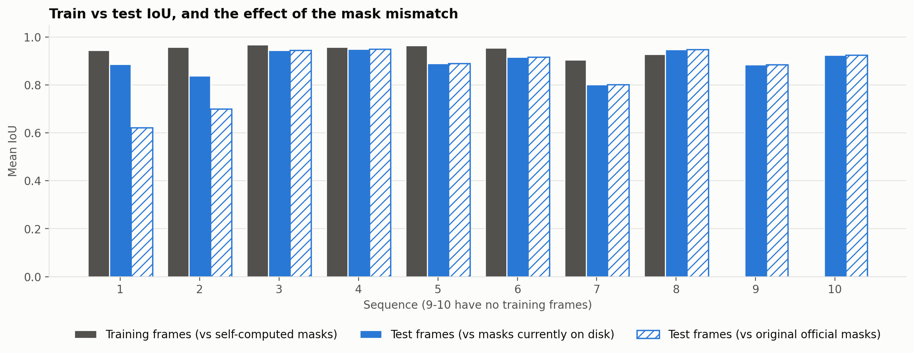

# Ground-truth checks

Checks of the training and test ground truth, prompted by comparing the
model's IoU on training frames against test frames. They found one
significant labelling problem (the ultrasound probe is labelled as
instrument in sequences 1 and 2), one corrupt-mask problem (sequence 7) and
one model weakness the test set cannot see (false alarms on frames with no
instrument). Nothing in the dataset, the merge scripts or the model was
changed while doing this; the fixes in [What to do](#what-to-do) are for
you to decide.

## Summary

| # | Issue | Affects | Effect on reported results |
|---|---|---|---|
| 1 | Self-computed masks include the `Other_labels` class (looks like the ultrasound probe) | Training masks and, via `fix_test_masks.py`, the test masks of sequences 1-2 | Sequences 1-2 are over-scored: 0.887 / 0.837 become **0.621 / 0.699** against the original official masks; pooled IoU 0.900 becomes **0.875**. Held-out sequences 9-10 are unaffected (0.904) |
| 2 | Self-computed masks for sequence 7 frames 267-272 cover the entire image | Self-computed masks only | None on reported scores (test scoring uses the official masks); training masks are unaffected |
| 3 | 22 training frames contain no instrument; the model predicts one on 12 of them | Model behaviour | Invisible in test metrics: the test set has no instrument-free frames |
| 4 | Train/test gap of 0.05 IoU on sequences 1-8 | Model | Moderate, not overfitting to ~1.0 |

Scripts: `scripts/evaluation/evaluate_train_split.py`,
`scripts/evaluation/evaluate_original_masks.py`,
`scripts/analysis/compare_mask_sources.py`,
`scripts/analysis/compare_train_vs_test.py`.

## 1. The ultrasound probe is labelled as instrument (sequences 1 and 2)

The model trains on self-computed binary masks made by merging every class
folder under `ground_truth/` (`scripts/data_prep/make_binary_masks.py`) and
is tested against the official EndoVis masks. Comparing the two sources on
every test frame:

| Sequence | Frames | Mean IoU (ours vs official) | Min IoU | Frames < 0.95 | Instrument area, ours | Instrument area, official |
|---|---:|---:|---:|---:|---:|---:|
| 1 | 75 | 0.687 | 0.307 | 56 | 10.0% | 6.8% |
| 2 | 75 | 0.809 | 0.348 | 34 | 9.4% | 7.1% |
| 3 | 75 | 1.000 | 1.000 | 0 | 15.6% | 15.6% |
| 4 | 75 | 1.000 | 1.000 | 0 | 18.4% | 18.4% |
| 5 | 75 | 1.000 | 1.000 | 0 | 10.8% | 10.8% |
| 6 | 75 | 1.000 | 1.000 | 0 | 16.5% | 16.5% |
| 7 | 75 | 0.943 | 0.286 | 6 | 27.4% | 21.7% |
| 8 | 75 | 1.000 | 1.000 | 0 | 17.4% | 17.4% |
| 9 | 300 | 1.000 | 1.000 | 0 | 10.2% | 10.2% |
| 10 | 300 | 1.000 | 1.000 | 0 | 12.2% | 12.2% |
| All | 1200 | 0.965 | 0.286 | 96 | 13.5% | 12.8% |

Sequences 3-6 and 8-10 agree exactly: the merge logic reproduces the official
labels. Sequences 1 and 2 do not, and both have an extra `Other_labels`
folder that the other sequences lack.

**Evidence that `Other_labels` is the cause.** Rebuilding the masks for
sequences 1 and 2 *without* `Other_labels` gives IoU **1.0000** against the
original official masks on all 150 test frames (minimum 1.000). Overlaying
`Other_labels` on the frames shows a long, rounded-tip tool lying across the
scene; it looks like the drop-in ultrasound probe, and the challenge paper
says dataset 1 contains one. The paper defines the probe as background, and
the official masks follow that. `Other_labels` covers about 3.5% of the frame
on essentially every training frame of sequences 1 and 2 (roughly a fifth of
the labelled area). I inferred that it is the probe from the images and the
paper; the folder name alone does not say.

**How it went wrong.** `fix_test_masks.py` and the `segmentation/dataset.py`
docstring concluded that the official masks for sequences 1-2 "omit a visible
instrument" and replaced them with the self-computed ones. The official masks
were right; the extra "instrument" is the probe.

**Effect.** The model learned to segment the probe as instrument, and its
test scores on sequences 1-2 were computed against masks that also contain the
probe. Scored against the original official masks:

| Sequence | Train IoU | Test IoU (masks on disk) | Train - test | Test IoU (original official masks) | Train - test (original) |
|---|---:|---:|---:|---:|---:|
| 1 | 0.944 | 0.887 | +0.057 | 0.621 | +0.323 |
| 2 | 0.958 | 0.837 | +0.121 | 0.699 | +0.259 |
| 3 | 0.968 | 0.944 | +0.024 | 0.944 | +0.024 |
| 4 | 0.958 | 0.949 | +0.009 | 0.949 | +0.009 |
| 5 | 0.964 | 0.890 | +0.074 | 0.890 | +0.074 |
| 6 | 0.955 | 0.916 | +0.039 | 0.916 | +0.039 |
| 7 | 0.905 | 0.801 | +0.105 | 0.801 | +0.105 |
| 8 | 0.927 | 0.947 | -0.020 | 0.947 | -0.020 |
| 9 | - | 0.884 | - | 0.884 | - |
| 10 | - | 0.924 | - | 0.924 | - |
| Mean, sequences 1-8 | 0.947 | 0.896 | +0.051 | 0.846 | +0.102 |
| Mean, all 10 (test only) | - | 0.900 | - | 0.875 | - |

The hatched bars in the figure show the difference:



Sequences 1 and 2 fall from 0.887 to 0.621 and from 0.837 to 0.699 (the
probe predictions are now false positives). Pooled IoU over all 1,200 test
frames falls from 0.900 to 0.875, about level with UB (0.875) and behind MIT
(0.888) in the challenge table. The held-out result is unchanged: sequences
9-10 have no `Other_labels` class, their masks match the official ones
exactly, and IoU there is 0.904, still above every challenge team.

## 2. Corrupt self-computed masks in sequence 7

For sequence 7 frames 267-272 the self-computed mask is the **whole image**
(100% foreground) while the official mask covers about 29%. Some per-class
label file in that sequence is all-nonzero on those frames; I did not
identify which. Because the model is scored against the official masks,
reported test scores are unaffected, and no *training* mask has this problem
(the largest training mask covers 38% of the frame; none exceed 60%). It
does mean anything built from `binary_masks/` for those frames is wrong.

## 3. The model hallucinates instruments on empty frames

| Sequence | Training frames with no instrument | Model predicted nothing (correct) | Model hallucinated an instrument | False-alarm rate |
|---|---:|---:|---:|---:|
| 5 | 3 | 3 | 0 | 0% |
| 7 | 19 | 7 | 12 | 63% |
| All | 22 | 10 | 12 | 55% |

Twenty-two training frames (19 in sequence 7, 3 in sequence 5) show tissue
only, so an empty mask is correct. The model predicts an instrument on 12 of
them (blobs covering 0.1-7% of the frame), even though these are frames it
trained on. These are not label errors; they account for the twelve
training frames with IoU exactly 0.0 and for sequence 7 having the lowest
training IoU (0.905). Excluding the empty frames, training IoU rises from
0.9475 to 0.9536.

The test set contains no instrument-free frames, so test IoU cannot show this
weakness. It matters for any use where instruments can leave the view.

## 4. Train versus test

Training IoU is 0.947 on sequences 1-8 against 0.896 on their test frames, a
gap of 0.051. Per sequence the gap ranges from -0.020 (sequence 8, where test
is higher) to +0.121 (sequence 2); sequences 7 (+0.105) and 5 (+0.074) are
also large. Training IoU does not approach 1.0, which fits the edge-precision
ceiling described in [ERROR_ANALYSIS.md](ERROR_ANALYSIS.md) rather than
memorization. Sequences 1-8 test frames come from the same videos as the
training frames, so the true gap on unseen videos could be larger, although
sequences 9-10 (never trained on) score 0.904, similar to 0.896 on 1-8.

## What to do

Not done; each needs your decision.

1. **Fix the masks.** Exclude `Other_labels` in `make_binary_masks.py`,
   regenerate `binary_masks/`, and restore the official test masks from the
   `*_official_backup/` folders (this undoes `fix_test_masks.py`, which can
   then be removed).
2. **Retrain.** The training masks for sequences 1-2 change, so the current
   checkpoint learned the probe as instrument. After retraining, re-run
   `evaluate_model`, `baseline_threshold`, `per_frame_errors` and the analysis
   scripts so every table and figure regenerates.
3. **Interim option without retraining.** Report sequences 1-2 against the
   original official masks (`model_eval_original_masks.json`) and state the
   limitation.
4. **Documents that are wrong until then:** the README results table
   (pooled 0.900; held-out unaffected), `challenge_per_dataset` rows 1-2 and
   the all-10 leaderboard column, ERROR_ANALYSIS.md (sequence 1-2 figures; it
   calls our masks "corrected"), and the docstrings in
   `segmentation/dataset.py` and `fix_test_masks.py` claiming the official
   masks omit an instrument.
5. **Consider adding instrument-free frames** to the test metrics and to
   training if false alarms matter.

## Reproduce

```bash
python3 -m scripts.evaluation.evaluate_train_split      # ~5 min
python3 -m scripts.evaluation.evaluate_original_masks   # ~3 min
python3 -m scripts.analysis.compare_mask_sources
python3 -m scripts.analysis.compare_train_vs_test
```
